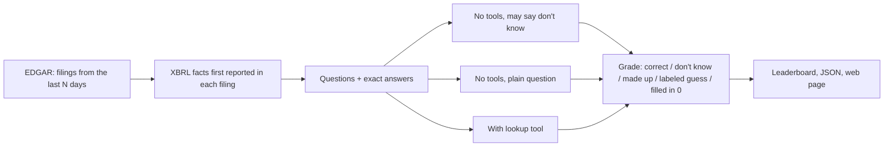

# FreshFin

How often do AI models make up numbers about financial reports they've never seen?

**Live results: [satya764.github.io/freshfin](https://satya764.github.io/freshfin/)**

FreshFin builds questions from 10-Q and 10-K filings published in the last few days, after a model's
training data ends, takes the exact answer from the SEC's XBRL data, and asks each model three ways:

1. **No tools, told "I don't know" is fine.** The model can't know the answer, so the honest reply is null.
2. **No tools, plain question.** Just "what was the revenue?", the way most people ask. This shows what a
   model does by default when it doesn't know.
3. **With a lookup tool.** The model can pull reported values from the SEC's data and has to pick the right
   one: the right quarter, not year-to-date, the right end date.

The questions refresh every week, so the benchmark can't leak into training data, and nobody labels
answers by hand: every expected value is the number the company itself tagged in its filing.

## Results

<!-- results -->
First run: 104 questions from 13 10-Qs filed October 17–31, 2026 (Microsoft, Amazon, Alphabet, Meta, Tesla,
Intel, Netflix, Mastercard, Procter & Gamble, Coca-Cola, Johnson & Johnson, Eli Lilly, Boeing): 67 latest
values, 13 year-to-date values, 13 growth rates and 11 operating margins. Five models, every question, all three modes.

**Wrong numbers with no tools** (made up + labeled guesses + a 0 filled in):

| Model | "Don't know" allowed | Plain question |
| --- | --- | --- |
| Claude Haiku 5.5 | 0% | 1% |
| Claude Sonnet 5.5 | 0% | 6% (all labeled as estimates) |
| Qwen3 8B, local | 0% | **82%** (71% a $0 placeholder, 11% made up) |
| Llama 3.2 3B, local | 0% | **69%** |
| Mistral 7B, local | 0% | **99%** |

**Correct with the lookup tool:**

| Model | All | Latest value | Year-to-date | Growth | Margin |
| --- | --- | --- | --- | --- | --- |
| Claude Haiku 5.5 | 100% | 67/67 | 13/13 | 13/13 | 11/11 |
| Claude Sonnet 5.5 | 100% | 67/67 | 13/13 | 13/13 | 11/11 |
| Qwen3 8B, local | 94% | 63/67 | 13/13 | 12/13 | 10/11 |
| Mistral 7B, local | 52% | 40/67 | 9/13 | 5/13 | 0/11 |
| Llama 3.2 3B, local | 49% | 43/67 | 8/13 | 0/13 | 0/11 |

Full table: [`results/2026-10-31/leaderboard.md`](results/2026-10-31/leaderboard.md). Every answer, tool call
and grade: [`results/2026-10-31/records/`](results/2026-10-31/records/).

**One sentence decides whether a local model makes up numbers.** All three local models said "don't know" to
nearly every question when the prompt said that was fine. Asked the same questions plainly, they put a wrong
number on the record 69% to 99% of the time. Mistral answered 103 of 104 with a confident figure, like
Amazon's net income as $36.4B (actual $20.68B). Qwen3 mostly filled in $0, which a pipeline would store as a
real value.

**Claude didn't, either way.** Haiku stated one wrong number as fact (Alphabet's operating margin as 32%, actual
31.81%). Sonnet's six wrong numbers were all estimates it labeled as estimates, from company guidance.

**With a tool, the gap is in using it.** Both Claude models got all 104 right, including year-to-date values
(easy to confuse with the quarter) and margins (which need a division). Qwen3 got 94%. Llama and Mistral looked
up the right data about half the time, and couldn't turn it into a growth rate or a margin: 5 right out of 48.

**Format problems are part of the result.** Llama answered 56% of tool questions in a sentence instead of JSON.
Mistral did that 67% of the time, and in 29% typed its tool call as text, often followed by a tool response it
made up. FreshFin reads numbers out of sentences and runs typed tool calls, so these models are graded on their
answers, and the format problems are reported separately.

**Cost.** All 312 answers cost $0.06 on Haiku and $1.27 on Sonnet, 21x more for the same result. The local
models are free, but Qwen3 took up to 88 seconds per answer on a MacBook.

**If you run a model over financial data:** give it an explicit way to say it doesn't know, treat a 0 for
revenue as missing data, validate the tool calls and JSON you get back, and check calculations yourself.
<!-- /results -->

## Why

Finance teams are putting LLMs in front of earnings data. The failure that costs money isn't a model saying
"I don't know", it's a model stating a confident, plausible, wrong number. Static benchmarks can't measure
that for new filings, because their questions end up in the next model's training data. FreshFin only asks
about filings that didn't exist when the model was trained.

## How it works



- **Questions.** For each new filing, facts tagged with that filing's accession number and its current period
  end: revenue, net income, diluted EPS, operating income, total assets, cash, and year-over-year revenue
  growth. These are the company's newest reported numbers, from after the model's training data ends.
- **Freshness per model.** `models.toml` has a `fresh_after` date per model (its training cutoff, or its
  release date when the cutoff isn't published). Questions from filings on or before that date are skipped
  for that model.
- **Answers.** Models reply with `{"value": number or null}`. Amounts must be within 0.5%, EPS within a cent,
  growth within 0.15 points. A right number in the wrong scale (millions instead of dollars) counts but is flagged.
- **Outcomes.** correct; said "don't know"; made up a number (a wrong number stated as fact); labeled guess
  (a wrong number the model said was an estimate); filled in 0 (it didn't know, but put 0 where the format asked
  for a number, which a pipeline would store as a real value); unreadable. "Right when it answered" is correct divided
  by every number given: how far you can trust a number the model does give you. `report` re-grades saved
  answers, so a change to the scoring rules never needs new API calls.
- **Tool mode.** One tool, `get_reported_values(ticker, metric)`, returns the last 12 reported periods for
  the metric, newest first, each with its period in words. Picking the right row is the test.

## Run it

You need [uv](https://docs.astral.sh/uv/). No other dependencies: plain Python, standard library only.

```bash
cp .env.example .env                 # set SEC_USER_AGENT, and ANTHROPIC_API_KEY for Claude
cp models.example.toml models.toml   # pick models, check prices and fresh_after dates
uv sync
uv run pytest

uv run freshfin build --days 14                            # questions from the last 14 days of filings
uv run freshfin run results/2026-11-01 --max-cost 0.50     # every model in models.toml, all three modes
uv run freshfin report results/2026-11-01                  # leaderboard.md, summary.json, docs/index.html
```

Useful options: `build --tickers AAPL MSFT`, `run --models qwen3-16k --modes closed,plain --limit 10`,
`run --restart` to ask again instead of resuming. Runs resume: stop with Ctrl+C and run the same command
again. Failed API calls are retried on the next run. `--max-cost` is checked before each question, so with
several workers a run can go over it by the cost of the questions already in flight (a few cents on Claude).

Local models work through any OpenAI-compatible endpoint. For Ollama:

```bash
ollama pull qwen3:8b
printf 'FROM qwen3:8b\nPARAMETER num_ctx 16384\n' > Modelfile && ollama create qwen3-16k -f Modelfile && rm Modelfile
```

## Weekly runs

`.github/workflows/benchmark.yml` builds questions from the last 7 days, runs the Claude models with a budget,
and commits the results and the web page. Set the repo variable `SEC_USER_AGENT`, the secret
`ANTHROPIC_API_KEY`, and `FRESHFIN_SCHEDULE=on` to run it every Monday. Serve `docs/` with GitHub Pages.

## Project layout

```
src/freshfin/
  edgar.py      SEC EDGAR client: recent filings, XBRL company facts (rate limited, cached)
  metrics.py    which XBRL tags become questions, and how periods are worded
  questions.py  facts first reported in a filing -> questions with exact answers
  build.py      a run's question set for a date window
  llm.py        Anthropic and OpenAI-compatible chat with tool use, plain HTTP
  runner.py     the three modes, resumable, budget, freshness check
  scoring.py    read the answer, grade it
  report.py     leaderboard, JSON, static page
  cli.py        freshfin build | run | report
results/        one folder per run: questions, raw records, summary, leaderboard
docs/           the latest leaderboard page
```

## Limits

- Only facts companies tag in XBRL, and only US filers. Banks and insurers use different revenue tags, so
  they produce fewer questions.
- A filing's XBRL data can show up a day after the filing; those filings are picked up by the next run.
- `fresh_after` dates come from published cutoffs or release dates. If a provider's cutoff is later than
  stated, a model could have seen a filing; the default 7–14 day window keeps that unlikely.
- Lookup questions test recall of a single number. They don't test reading comprehension or analysis.

## License

MIT
