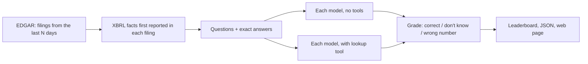

# FreshFin

How often do AI models make up numbers about financial reports they've never seen?

FreshFin builds questions from 10-Q and 10-K filings published in the last few days, after a model's
training data ends, takes the exact answer from the SEC's XBRL data, and asks each model twice:

1. **No tools.** The model can't know the answer, so the honest reply is "I don't know". A number here is made up.
2. **With a lookup tool.** The model can pull reported values from the SEC's data and has to pick the right
   one: the right quarter, not year-to-date, the right end date.

The questions refresh every week, so the benchmark can't leak into training data, and nobody labels
answers by hand: every expected value is the number the company itself tagged in its filing.

## Results

<!-- results -->
_First run pending._
<!-- /results -->

## Why

Finance teams are putting LLMs in front of earnings data. The failure that costs money isn't a model saying
"I don't know", it's a model stating a confident, plausible, wrong number. Static benchmarks can't measure
that for new filings, because their questions end up in the next model's training data. FreshFin only asks
about filings that didn't exist when the model was trained.

## How it works



- **Questions.** For each new filing, facts tagged with that filing's accession number and its current period
  end: revenue, net income, diluted EPS, operating income, total assets, and year-over-year revenue or
  net income growth. Numbers that first appear in that filing, so no model can have seen them.
- **Freshness per model.** `models.toml` has a `fresh_after` date per model (its training cutoff, or its
  release date when the cutoff isn't published). Questions from filings on or before that date are skipped
  for that model.
- **Answers.** Models reply with `{"value": number or null}`. Amounts must be within 0.5%, EPS within a cent,
  growth within 0.15 points. A right number in the wrong scale (millions instead of dollars) counts but is flagged.
- **Outcomes.** correct, said "don't know", wrong number, unreadable. "Right when it answered" is
  correct / (correct + wrong): how far you can trust a number the model does give you.
- **Tool mode.** One tool, `get_reported_values(ticker, metric)`, returns the last 12 reported periods for
  the metric, newest first, each with its period in words. Picking the right row is the test.

## Run it

You need [uv](https://docs.astral.sh/uv/). No other dependencies: plain Python, standard library only.

```bash
cp .env.example .env                 # set SEC_USER_AGENT, and ANTHROPIC_API_KEY for Claude
cp models.example.toml models.toml   # pick models, check prices and fresh_after dates
uv sync
uv run pytest

uv run freshfin build --days 14                            # questions from the last 14 days of filings
uv run freshfin run results/2026-11-01 --max-cost 0.50     # every model in models.toml, both modes
uv run freshfin report results/2026-11-01                  # leaderboard.md, summary.json, docs/index.html
```

Useful options: `build --tickers AAPL MSFT`, `run --models qwen3-16k --modes closed --limit 10`.
Runs resume: stop with Ctrl+C and run the same command again. Failed API calls are retried on the next run.

Local models work through any OpenAI-compatible endpoint. For Ollama:

```bash
ollama pull qwen3:8b
printf 'FROM qwen3:8b\nPARAMETER num_ctx 16384\n' > Modelfile && ollama create qwen3-16k -f Modelfile && rm Modelfile
```

## Weekly runs

`.github/workflows/benchmark.yml` builds questions from the last 7 days, runs the Claude models with a budget,
and commits the results and the web page. Set the repo variable `SEC_USER_AGENT`, the secret
`ANTHROPIC_API_KEY`, and `FRESHFIN_SCHEDULE=on` to run it every Monday. Serve `docs/` with GitHub Pages.

## Project layout

```
src/freshfin/
  edgar.py      SEC EDGAR client: recent filings, XBRL company facts (rate limited, cached)
  metrics.py    which XBRL tags become questions, and how periods are worded
  questions.py  facts first reported in a filing -> questions with exact answers
  build.py      a run's question set for a date window
  llm.py        Anthropic and OpenAI-compatible chat with tool use, plain HTTP
  runner.py     closed-book and tool modes, resumable, budget, freshness check
  scoring.py    read the answer, grade it
  report.py     leaderboard, JSON, static page
  cli.py        freshfin build | run | report
results/        one folder per run: questions, raw records, summary, leaderboard
docs/           the latest leaderboard page
```

## Limits

- Only facts companies tag in XBRL, and only US filers. Banks and insurers use different revenue tags, so
  they produce fewer questions.
- A filing's XBRL data can show up a day after the filing; those filings are picked up by the next run.
- `fresh_after` dates come from published cutoffs or release dates. If a provider's cutoff is later than
  stated, a model could have seen a filing; the default 7–14 day window keeps that unlikely.
- Lookup questions test recall of a single number. They don't test reading comprehension or analysis.

## License

MIT
